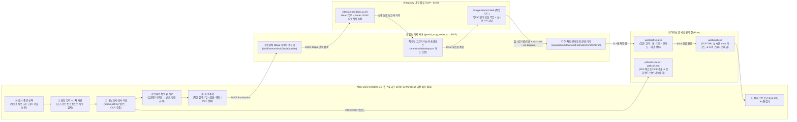

# 🏛️ ARCHAEO STUDIO 5.0 — 마스터 아키텍처 · UI 디자인 · 엔지니어링 완전 설계도
**(발굴조사보고서 『Ⅳ. 고찰』 · 학술논문 『논문』 × WordCraft 네이티브 통합 × Gemini '작업' 모드 × DBpia AI × PdfCraft 온디맨드 변환)**

> **설계도 목적**: 이 문서는 **어떤 AI 에이전트나 개발자에게 제공하더라도 질문이나 누락 없이 ARCHAEO STUDIO 5.0의 UI/UX 디자인, 프론트엔드 컴포넌트, 백엔드 CDP 브리지, DBpia AI 수집기, 고고학 학술 프롬프트 엔진, WordCraft/PdfCraft 네이티브 OOXML 조판 및 Rust 앱 패치, 바탕화면 아이콘·런처까지 100% 동일하게 처음부터 끝까지 재구축할 수 있도록** 모든 설계와 핵심 구현 코드를 빠짐없이 수록한 마스터 블루프린트입니다.

---

## 1. 시스템 핵심 철학 및 전체 아키텍처

### 1.1 왜 안티그라비티(Antigravity) 에이전트 코딩 쿼터가 0% 소모되는가?
1. **에이전트 API 미호출**: ARCHAEO STUDIO는 안티그라비티의 유료 코딩 에이전트(Claude/Gemini Cloud Code API)를 호출하지 않습니다.
2. **내장 웹뷰 CDP 직결**: 안티그라비티 PC 앱이 실행될 때 열리는 로컬 Chrome DevTools Protocol(CDP, 기본 `127.0.0.1:9223` 또는 `DevToolsActivePort`)을 통해 내부에 임베딩된:
   - **Google Gemini 웹 세션 (`https://gemini.google.com/app`, `4 Argon High` + `작업` 모드)**
   - **DBpia AI 웹뷰 (`https://ai.dbpia.co.kr`)**
   에 WebSocket으로 직접 연결합니다.
3. **무제한 고찰·논문 집필**: 로컬 브리지 서버(`scripts/gemini_mcp_server.js --bridge-only`, 포트 `18787`)가 DOM 제어와 JSON API 추출로 모든 데이터 수집·원고 집필을 수행하므로, 수십 편의 발굴조사보고서 『Ⅳ. 고찰』과 학술지 투고 논문을 반복 생성해도 **안티그라비티 에이전트 사용량은 단 1%도 차감되지 않습니다.**

### 1.2 WordCraft(`.docx`) 중심 단일 편집 · 필요시 PdfCraft(`.pdf`) 온디맨드 변환
- 모든 원고 작성, 표(`표 1`, `표 2`), 학술 차트(`wc-chart`), 단계별 변천 모식도(`wc-diagram`), 페이지 하단 반괄호 각주(`1)`, `2)`), `【참고문헌】` 편집은 **WordCraft(`.docx`)** 단일 문서 워크플로우로 이루어집니다.
- **PdfCraft(`pdfcraft.exe`)**는 작성 도중 자동으로 뜨지 않으며:
  1) 좌측 `③ 내 보고서·조사 자료`에 기존 발굴조사보고서 `.pdf`를 업로드했을 때 텍스트 추출 및 스캔본 ONNX OCR용 백그라운드 파서로 동작하고,
  2) 사용자가 상단 리본이나 실행부의 **[PDF로 내보내기]** 버튼을 명시적으로 눌렀을 때만 호출됩니다.

### 1.3 전체 데이터 흐름도 (End-to-End Pipeline)



---

## 2. UI/UX 디자인 시스템 완전 명세 (`tokens.css` & `bundle.css` & `standalone_studio_app.js`)

어떤 AI라도 동일한 화면을 1px 오차 없이 구현할 수 있도록 색상 토큰, 타이포그래피, 레이아웃 치수, 6단계 카드 구조를 모두 정의합니다.

### 2.1 디자인 미학 (Aesthetic Persona)
- **컨셉**: 국립문화유산연구원(NRICH) 발굴조사보고서 인쇄 조판 미학 + 한국고고학보 학술 서지 편집기.
- **배경 질감**: 차가운 순백색(`#FFFFFF`) 대신 눈의 피로를 줄이는 **한지·양피지 웜 아이보리(`#F6F2EA`)**를 기본 배경으로 삼고, 우측 편집 캔버스에는 실제 A4 인쇄 용지(`#FBF9F4`)가 놓인 형태로 설계합니다.
- **포인트 컬러 (단 3가지 상태 색상만 엄격 사용)**:
  1. **토기 테라코타 (`--as-accent: #A2492A`)**: 현재 선택된 문서 종류의 주 실행 버튼 딱 1개에만 사용.
  2. **청동 브라스 (`--as-brass: #8A6A1F`)**: `1차 가공` 배지 및 `디비피아 로그인` 연동 상태 표시에 사용.
  3. **청록 세이지 (`--as-ok: #2F6B4A`)**: 수집 완료 점(Dot) 및 진행률 바(`progressbar`)에 사용.

### 2.2 전체 CSS 디자인 토큰 (`assets/archaeo-studio/tokens.css`)

```css
:root,
[data-theme="light"] {
  /* 배경 계층 (Warm Hanji / Parchment) */
  --as-bg-app: #f6f2ea;          /* 앱 전체 배경 */
  --as-bg-panel: #efe9dc;        /* 좌측 스튜디오 패널 / 리본 배경 */
  --as-bg-elev: #fbf8f1;         /* 카드 / 입력창 배경 */
  --as-bg-subtle: #e7dfd0;       /* 보조 박스 / 1차 가공 프리뷰 배경 */
  --as-bg-hover: rgba(32, 26, 19, 0.055);
  --as-bg-active: rgba(32, 26, 19, 0.095);
  --as-bg-canvas: #e5dec9;       /* 우측 A4 용지 뒤 책상 배경 */
  --as-bg-page: #fbf9f4;         /* A4 용지 표면 */

  /* 잉크 텍스트 계층 */
  --as-ink-1: #1f1b16;           /* 주 본문 / 제목 (먹색) */
  --as-ink-2: #4c443a;           /* 부제목 / 레이블 */
  --as-ink-3: #786e60;           /* 힌트 / 메타 정보 */
  --as-ink-4: #9b9080;           /* 비활성 / 플레이스홀더 */

  /* 경계선 계층 */
  --as-border-1: #ded6c5;        /* 기본 구분선 */
  --as-border-2: #c9beaa;        /* 강조 구분선 / 입력창 테두리 */
  --as-border-focus: #8d4b32;    /* 포커스 링 */

  /* 고고학 시맨틱 액센트 */
  --as-accent: #a2492a;          /* 토기 테라코타 (주 실행 버튼) */
  --as-accent-hover: #8c3c20;
  --as-accent-soft: rgba(162, 73, 42, 0.12);
  --as-accent-ink: #fffaf3;

  --as-brass: #8a6a1f;           /* 청동 브라스 (1차 가공 / DBpia) */
  --as-brass-soft: rgba(138, 106, 31, 0.13);

  --as-ok: #2f6b4a;              /* 세이지 그린 (수집/완료 상태) */
  --as-ok-soft: rgba(47, 107, 74, 0.13);
  --as-warn: #a0611a;
  --as-danger: #a63429;

  /* 타이포그래피 */
  --font-sans: "Pretendard Variable", "Pretendard", "Malgun Gothic", "맑은 고딕", system-ui, sans-serif;
  --font-serif: "Noto Serif KR", "Source Han Serif KR", "Batang", "바탕", Georgia, serif;
  --font-mono: "JetBrains Mono", "Consolas", monospace;

  /* 치수 및 반경 */
  --r-xs: 3px;
  --r-sm: 5px;
  --r-md: 7px;
  --r-lg: 10px;
  --shadow-page: 0 2px 6px rgba(25, 20, 14, 0.08), 0 18px 38px -18px rgba(25, 20, 14, 0.22);
}

[data-theme="dark"] {
  --as-bg-app: #161411;
  --as-bg-panel: #1d1a16;
  --as-bg-elev: #24201b;
  --as-bg-subtle: #2b2620;
  --as-bg-hover: rgba(245, 236, 220, 0.06);
  --as-bg-active: rgba(245, 236, 220, 0.11);
  --as-bg-canvas: #12100d;
  --as-bg-page: #1f1c17;

  --as-ink-1: #ede6d8;
  --as-ink-2: #bfb6a5;
  --as-ink-3: #8c8374;
  --as-ink-4: #655e52;

  --as-border-1: #2e2922;
  --as-border-2: #3e372e;
  --as-border-focus: #d07654;

  --as-accent: #c96846;
  --as-accent-hover: #d87856;
  --as-accent-soft: rgba(201, 104, 70, 0.18);
  --as-accent-ink: #1b1410;

  --as-brass: #cfa54a;
  --as-brass-soft: rgba(207, 165, 74, 0.16);
  --as-ok: #5aa47b;
  --as-ok-soft: rgba(90, 164, 123, 0.16);
}
```

### 2.3 화면 5대 영역 구조 및 정확한 치수
1. **최상단 창 제목줄 (`.as-winbar`, 높이 `34px`)**:
   - 좌측: 문서 파일명(`기안동 유적 Ⅳ 고찰.docx - ARCHAEO STUDIO`) + `WordCraft 통합` 배지.
   - 우측: `WordCraft 데스크톱 열기 (.docx)` 버튼 + `어두운 화면 / 밝은 화면` 테마 전환 버튼.
2. **WordCraft 리본 툴바 (`.as-ribbon`, 높이 `62px`)**:
   - 그룹 1 (`파일`): `새 문서`, `열기`, `저장 (.docx)`
   - 그룹 2 (`홈 · 서식`): `글자`(본문 명조 ↔ 고딕 전환)
   - 그룹 3 (`삽입`): `표`(`<표 1>` 즉시 삽입), `도면`(학술 차트·모식도 삽입), `각주`(`1)` 반괄호 각주 삽입)
   - 그룹 4 (`스튜디오`): `스튜디오`(좌측 380px 패널 접기/펴기 토글)
   - 그룹 5 (`내보내기`): `PDF 변환`(온디맨드 PdfCraft 변환 다이얼로그 호출)
   - 우측 끝: 단축키 검색 안내(`명령 찾기 Ctrl K`)
3. **좌측 고정 6단계 스튜디오 패널 (`.as-screen__studio`, 폭 `380px`, 접힘 시 `0px`)**:
   - **① 문서 종류**: 2분할 세그먼트 스위치 (`발굴조사보고서 고찰` vs `학술논문`). 선택에 따라 ⑤번 실행 버튼 중 해당 버튼만 테라코타(`--as-accent`) 색상으로 활성화됨.
   - **② 요청**: 자유 텍스트 입력창 + `[1차 가공]` 황동 태그 + `▸ 가공된 요청 보기` 토글(열면 `buildFirstStageEngineeredPrompt()` 결과를 실시간 표시).
   - **③ 내 보고서·조사 자료**: 유구·유물 현황 텍스트 입력창 + `[파일 불러오기]`(`.docx`, `.pdf`, `.txt`, `.md`, `.csv` 다중 업로드 → `PdfCraft`/`WordCraft` CLI가 텍스트 및 스캔본 OCR을 자동 추출하여 텍스트창에 주입하고 하단에 파일 칩 표시).
   - **④ 연대분석·보유 자료 (`선택`)**: 우측 상단에 `비워 두면 빼고 작성` 태그 표시. 입력값이 없으면 절대연대 수치를 절대 지어내지 않고 상대편년만으로 논증.
   - **⑤ 실행**:
     - `▶ 고찰 실행` / `▶ 논문 실행`
     - 보조 제어줄: `[일시 멈춤]`, `[그만두기]`
     - 하단 연동줄: `[디비피아 로그인]` + `● 로그인됨` 상태 필 + `[PDF로 내보내기]`
   - **⑥ 진행 기록**: 상단 실시간 프로그레스 바(`0% ~ 100%`) + 타임스탬프 단계별 로그 리스트.
4. **우측 WordCraft A4 편집 캔버스 (`.as-screen__canvas`, `flex: 1`)**:
   - 상단 수집 스트립(`.as-collect`, 높이 `32px`): `● DBpia 논문 수집 중 16건` | 프로그레스 바 | `WordCraft 창 열기` 버튼.
   - 중앙 스크롤 영역(`.as-screen__scroll`): 실제 A4 비율(`794px × 1123px`, 패딩 `64px 72px`)의 편집 가능한 문서 시트(`contenteditable="true"`).
   - 실시간 렌더링: Gemini가 작성 중인 마크다운 표, `wc-chart`(막대/선/파이 SVG 차트), `wc-diagram`(단계별 화살표 모식도), 본문 반괄호 각주(`1)`, `2)`) 및 페이지 하단 각주 분리선(`.as-page__notes`)을 실시간으로 조판하여 보여줌.
5. **하단 상태줄 (`.as-status`, 높이 `26px`)**:
   - 좌측 상태 힌트 + 우측 `쪽 1 / 1` · `글자 0` · 배율(`90% ▾`).

---

## 3. 바탕화면 아이콘(`archaeo_studio.ico`) 및 무창 실행기(`launch_archaeo_studio.vbs`) 설계

### 3.1 멀티 해상도 아이콘 생성 스크립트 (`assets/archaeo-studio/archaeo_studio.ico`)
- Windows 바탕화면에서 고해상도(DPI 125~200%)에서도 깨지지 않도록 `256×256`, `64×64`, `48×48`, `32×32`, `16×16` 5개 레이어를 포함한 정식 `.ico` 바이너리를 생성합니다.
- 디자인: 다크 슬레이트(`#141923`) 라운드 스퀘어 배경 + 황금색(`#D4AF37`) 이중 테두리 + 테라코타(`#D86432`) 고고학 토기(단경호) 실루엣 + 층위/모식도 황금 그리드 라인 + 하단 학술 문서 바.

### 3.2 검은 콘솔 창 없는 무창 실행기 (`scripts/launch_archaeo_studio.vbs`)
바탕화면 바로가기(`ARCHAEO STUDIO.lnk`)는 실행 시 검은색 CMD 창이 깜빡이지 않도록 `wscript.exe`로 아래 VBScript를 호출합니다:

```vbscript
Set WshShell = CreateObject("WScript.Shell")
Set FSO = CreateObject("Scripting.FileSystemObject")
ScriptDir = FSO.GetParentFolderName(WScript.ScriptFullName)
PluginRoot = FSO.GetParentFolderName(ScriptDir)
ServerJs = FSO.BuildPath(ScriptDir, "gemini_mcp_server.js")
WordCraftExe = FSO.BuildPath(PluginRoot, "bin\wordcraft\wordcraft-0.7.0-windows-x64-portable\wordcraft.exe")

' 1. 로컬 브리지 서버(포트 18787) 및 스탠드얼론 스튜디오를 백그라운드 무창(0) 모드로 기동
WshShell.Run "node """ & ServerJs & """ --on", 0, False

' 2. 만약 "--wordcraft" 인자가 전달되면 네이티브 WordCraft 데스크톱 앱도 함께 실행
If WScript.Arguments.Count > 0 Then
  If WScript.Arguments(0) = "--wordcraft" And FSO.FileExists(WordCraftExe) Then
    WshShell.Run """" & WordCraftExe & """ --control 7981", 1, False
  End If
End If
```

### 3.3 바탕화면 바로가기(`ARCHAEO STUDIO.lnk`) 생성 PowerShell 명령
```powershell
$WshShell = New-Object -ComObject WScript.Shell
$DesktopDir = [Environment]::GetFolderPath("Desktop")
$Shortcut = $WshShell.CreateShortcut((Join-Path $DesktopDir "ARCHAEO STUDIO.lnk"))
$Shortcut.TargetPath = "$env:SystemRoot\System32\wscript.exe"
$Shortcut.Arguments = "`"$PluginDir\scripts\launch_archaeo_studio.vbs`""
$Shortcut.WorkingDirectory = $PluginDir
$Shortcut.IconLocation = "$PluginDir\assets\archaeo-studio\archaeo_studio.ico,0"
$Shortcut.Description = "ARCHAEO STUDIO 5.0 - 한국 고고학 발굴조사보고서 Ⅳ.고찰 및 학술논문 집필 워크스테이션"
$Shortcut.Save()
```

---

## 4. 백엔드 브리지 핵심 기술 및 치명적 버그 방지 설계 (`scripts/gemini_mcp_server.js`)

다른 AI가 이 시스템을 재구축할 때 반드시 지켜야 할 **가장 중요한 3대 기술 규칙**입니다.

### 4.1 [핵심 규칙 1] Gemini `.ql-editor` 멀티라인 프롬프트 무손실 주입 (줄바꿈 조기 전송 & `TrustedHTML` 에러 동시 차단)
- **절대 하지 말아야 할 구현 2가지 (금지)**:
  1. `document.execCommand('insertText', false, fullPromptWithNewlines)`: 줄바꿈(`\n`)이 포함된 멀티라인 문자열을 `insertText`로 넣으면 Gemini의 Quill 에디터(`.ql-editor`)가 첫 번째 `\n`을 `Enter`(메시지 즉시 전송)로 처리하여 **맨 첫 줄 머리말만 전송되고 수만 자의 보고서 본문이 통째로 잘려 나갑니다!**
  2. `editor.innerHTML = ...`: `https://gemini.google.com/app`은 브라우저 CSP **Trusted Types (`TrustedHTML`)** 보안 정책이 강제되어 있어 `innerHTML` 대입 시 `TypeError: Failed to set the 'innerHTML' property on 'Element': This document requires 'TrustedHTML' assignment` 예외가 발생합니다!
- **올바른 무손실 주입 구현 (`_askGeminiWebImpl` 필수 코드 — `document.createElement('p')` + `p.textContent`)**:
  기존 자식 노드를 비운 뒤 줄 단위로 `document.createElement('p')`와 `p.textContent = line`을 사용하여 DOM 노드를 직접 추가하고, 커서를 맨 끝으로 옮긴 뒤 **줄바꿈 없는 단일 공백(`' '`)만 `insertText`로 트리거**해야 `TrustedHTML` 에러 없이 30,000자 이상의 고고학 보고서 원문과 DBpia 서지 데이터가 단 한 글자도 잘리지 않고 전송됩니다.
  ```javascript
  const rawText = String(fullPrompt || '');
  while (editor.firstChild) editor.removeChild(editor.firstChild);
  for (const line of rawText.split(/\r?\n/)) {
    const p = document.createElement('p');
    if (line) p.textContent = line;
    else p.appendChild(document.createElement('br'));
    editor.appendChild(p);
  }

  const sel = window.getSelection();
  const range = document.createRange();
  range.selectNodeContents(editor);
  range.collapse(false);
  sel.removeAllRanges();
  sel.addRange(range);
  document.execCommand('insertText', false, ' ');
  editor.dispatchEvent(new InputEvent('input', { bubbles: true, inputType: 'insertText', data: ' ' }));
  editor.dispatchEvent(new Event('change', { bubbles: true }));
  ```

### 4.2 [핵심 규칙 2] Google Workspace(Gmail · Google Drive · Google Docs) 확장 호출 원천 차단 및 DBpia 단독 검색
- **왜 Google Workspace가 호출되었는가?**
  1) 구버전 브리지 프로세스가 포트 `18787`을 점유한 상태에서 줄바꿈 조기 전송 버그 또는 `TrustedHTML` 에러로 인해 첫 줄(`[1차 가공 완료 · 작성 형식: 발굴조사보고서 『Ⅳ. 고찰』]`)만 전송되었을 때, 본문이 없자 제미나이가 사용자의 Gmail이나 Google 드라이브에서 `'발굴조사보고서'` 문서를 찾으려고 Google Workspace 확장을 자동 실행했습니다.
  2) 또한 프롬프트 내부에 `@Google Workspace`, `@Gmail`, `@Google Drive` 같은 `@확장명` 키워드가 들어가면(심지어 "쓰지 말라"는 부정문이라 하더라도) 제미나이 파서가 이를 확장 프로그램 호출 태그로 인식해 연결 팝업을 띄웁니다.
- **완벽 해결 아키텍처 (오직 제미나이 + DBpia AI만 순수 연동)**:
  1) **2단계 제미나이 호출 전면 제거**: `runArchaeologyDiscussionPipeline()`의 2단계에서는 제미나이를 절대 호출하지 않고, `buildDeterministicDbpiaQueries()`가 사용자 입력 및 업로드 보고서에서 유적명(예: `강릉 병산동`, `경산 임당동`), 시대(`초기철기`, `원삼국`, `삼국시대`), 유구/유물(`주거지`, `목곽묘`, `구들`, `토기`) 키워드를 즉시 추출해 **100% DBpia AI(`askDbpiaAi`)로만 직행**합니다.
  2) **프롬프트 내 `@` 멘션 및 외부 앱 이름 완전 배제**: 프롬프트에 `Google`, `Drive`, `Gmail`, `Workspace` 단어를 일절 넣지 않고, `"외부 도구나 외부 문서를 일절 조회하지 말고 바로 이 메시지 아래에 직접 수록된 기초 조사자료와 DBpia 학술논문 서지 데이터만을 근거로 지금 즉시 완성된 원고 본문 전체를 작성하십시오"`로 지시합니다.
  3) **브리지 서버 시작 시 구버전 포트(`18787`) 점유 프로세스 자동 교체 (`ensureBridgeServerProcess`)**: 스튜디오 실행 시 이전 프로세스가 남아 구버전 코드를 실행하는 일이 없도록 유휴 프로세스를 자동 종료하고 최신 코드로 기동합니다.

### 4.3 [핵심 규칙 3] DBpia AI 하이브리드 수집 엔진 (React DOM + Vetter JSON API `node_autr`·`node_pbsh_yy`·`node_plct_nm` + OpenAlex/DBpia 병렬 서지 보강)
`askDbpiaAi(query)`, `extractLatestDbpiaAnswer()`, 및 `enrichDbpiaReferencesMetadata()`는 다음 3단계로 국내외 학술논문·발굴조사보고서 서지정보를 무손실 수집합니다:
1. **질의 전송**: `https://ai.dbpia.co.kr/ko/search`의 `#agent-search-textarea`에 `HTMLTextAreaElement.prototype.value` 네이티브 세터로 검색어를 주입·전송하거나, 실패 시 `https://ai.dbpia.co.kr/ko/search/redirect?message=${encodeURIComponent(query)}&searchType=dbpia_landing&source=DBpia_main`으로 즉시 이동합니다.
2. **REA로 발굴한 Vetter Agent 내부 JSON API 직접 조회 (`node_autr`, `node_pbsh_yy`, `node_plct_nm`, `hovers`)**:
   응답 완료 후 URL 경로(`/search/{convId}` 또는 `/deep-research/{convId}`)에서 대화 ID를 추출하여 브라우저 세션 쿠키(`credentials: 'include'`)로 다음 API를 직접 호출합니다:
   - 일반 AI 검색: `GET https://agent.dbpia.co.kr/vetter_conversations/${convId}`
   - 딥리서치: `GET https://drs-api.dbpia.co.kr/deepresearch_conversations/${convId}`
   - `messages[last].references` 배열 내 각 객체의 실제 필드명 규격:
     - `node_id`: 국내 논문(`NODE12737994`) 또는 해외 OpenAlex 논문(`W4411273501`)
     - `node_title`: 논문 원제
     - `node_autr`: 저자명 (예: `"<오대양>"`, `"<권봉재, 유기윤>"` ➔ 양끝 `< >` 제거 및 `·` 결합)
     - `node_pbsh_yy`: 발행연도 (예: `2026`)
     - `node_plct_nm`: 국내 학술지명 (예: `"인문콘텐츠"`, `"보존과학회지"`)
     - `node_iprd_nm`: 발행기관·학회명 또는 해외 학술지명 (예: `"인문콘텐츠학회"`, `"ISPRS International Journal of Geo-Information"`)
     - `dmst_lstd_info` / `ovse_lstd_info`: 등재 정보 (`"KCI우수등재"`, `"SCOPUS"`, `"SCI(E)"`)
   - `messages[last].hovers`: `{ "NODE12737994_0": { "content": "본문 인용 스니펫..." } }` 구조에서 논문별 핵심 인용 단락을 추출합니다.
3. **권·호수 및 수록 쪽수(`00~00쪽`) 병렬 보강 (`enrichDbpiaReferencesMetadata`)**:
   - 국내 논문(`NODE...`): `https://www.dbpia.co.kr/journal/articleDetail?nodeId=NODE...`의 `citation_authors`, `citation_volume`, `citation_issue`, `citation_firstpage`, `citation_lastpage` 메타태그를 병렬 파싱하여 `제80호, 167~190쪽`까지 완성합니다.
   - 해외 논문(`W...`): OpenAlex 단일 배치 API(`https://api.openalex.org/works?filter=openalex:W1|W2|...&per-page=50`)로 권·호·쪽수·저자명을 일괄 보강합니다.

### 4.4 [핵심 규칙 4] `/goal` 기반 8대 판단 기준 수립 · 다각도 DBpia 수집 · 자율 교차검증 루프
단 1회 질문·답변으로 끝나는 단순 생성 방식이 아니라, 파이프라인 시작 시점에 **국가유산청 『문화재발굴조사보고서 Ⅳ. 고찰』 작성 기준** 또는 **대학원 석사학위 논문 이상(『한국고고학보』 등재학술지) 심사 기준**에 부합하는 **8대 완료 판단 기준(`buildGoalPlanAndRubric`)**을 수립하고, 모든 기준이 통과(`8/8 충족 · 100점`)될 때까지 자율 루프를 수행합니다:
1. **Phase 1 (`/goal` 완료 기준 및 검색 계획 수립)**:
   - `C1_DBPIA_SUFFICIENCY`: 다각도 선행연구 서지 데이터 충분성 (최소 3개 학술 관점 검색 · 실존 논문 8~10편 이상 · 실제 저자·연도·학술지 확보)
   - `C2_SECTION_STRUCTURE`: 국가유산청 『Ⅳ. 고찰』 또는 석사학위 논문 필수 장·절 및 국·영문 초록 완결성
   - `C3_ARGUMENT_DEPTH`: 학술 논증 심층성·연구사 비판 및 목표 분량 충족 (학술 종결어미 `~로 파악된다/편년된다` 및 목표 글자수)
   - `C4_QUANTITATIVE_TABLES`: 고고학 정량 데이터 마크다운 학술 표 2종 이상 (`표 1` 속성 일람표, `표 2` 주변 유적 비교 대비표)
   - `C5_NATIVE_CHART_DIAGRAM`: WordCraft 네이티브 차트(`wc-chart`) 및 단계별 모식도(`wc-diagram`) JSON 스펙 완비
   - `C6_FOOTNOTE_RIGOR`: 실전 학술 각주 밀도 및 저자명·연도·학술지 완비 (`'저자미상'`·`'연도미상'` **0건**)
   - `C7_CROSS_REF_CONSISTENCY`: 본문 인용 `1)`~`N)` ↔ `【각주】` ↔ `【참고문헌】` 1:1 교차검증 일치성 및 표준 인용부호(`「 」`, `『 』`, `쪽`) 준수
   - `C8_DATA_FIDELITY_COMPLETENESS`: 원자료 정합성(허구 연대·수치 날조 금지) 및 문장 완결성
2. **Phase 2 (다각도 DBpia AI 선행연구 수집 & 데이터 충분성 검증 루프)**:
   - `buildMultiFacetedDbpiaQueries()`가 1차 라운드에서 ① 연구사·구조·방법론, ② 유물 형식분류·속성·편년, ③ 주변 비교유적·지역 전개·적용사례의 **3개 학술 각도**로 DBpia AI를 연속 검색합니다.
   - 1차 수집 후 실제 저자·연도가 검증된 논문 수가 목표치에 미달하면 2차 심화 검색어로 자동 보충 검색을 수행합니다.
3. **Phase 3 & 4 (원고 집필 ➔ 결정론적 서지 정합성 보정 ➔ `/goal` 8대 기준 교차검증 및 자율 보완 루프)**:
   - 제미나이 초안 생성 직후 `repairAndEnrichManuscriptWithVerifiedRefs()`가 본문 인용 번호 `1)`~`N)`과 `### 【각주】`, `### 【참고문헌】`을 DBpia 검증 서지(`collectedPapers`)와 1:1로 매핑하고 `'저자미상'`을 원천 제거합니다.
   - `evaluateArchaeologyManuscriptQuality()`로 8대 기준 충족 여부를 채점하여 미충족 항목이 있으면 `buildCrossVerificationRevisionPrompt()`로 자율 보완 루프를 실행하고, **8/8(100점) 검증 완료 시에만 루프를 멈추고 WordCraft(`.docx`)를 컴파일·실행**합니다.
   - Studio UI 좌측 Step 6(`진행 기록 · /goal 교차검증`)의 실시간 현황판(`#goal-scorecard-box`)에 8대 항목별 `통과/미충족` 배지와 총점(`100점`)을 실시간 표시합니다.

---

## 5. 한국 고고학 『Ⅳ. 고찰』 & 『논문』 6대 학술 품질 규칙 및 OOXML 변환 파이프라인

### 5.1 6대 학술 품질 규칙 (`buildAdaptiveMasterPrompt`)
1. **1차 가공 (`buildFirstStageEngineeredPrompt`)**: 사용자의 짧은 요청을 한국 고고학 표준 장·절 목차와 논증 지침으로 자동 확장.
2. **없는 자료 날조 절대 금지 (`없는 자료는 없는 대로`)**:
   - `datingText`가 비어 있으면 **임의의 시료번호(예: `AMS-01`), BP 연대, 보정연대 수치를 절대 지어내지 않고**, 오직 출토유물 형식 분류와 유구 중복관계에 의한 **상대편년**만으로 서술.
   - `reportText`가 비어 있으면 가상의 유구 번호나 허구 계측치를 지어내지 않고 주제 및 DBpia 선행연구 중심으로 서술.
3. **유구 중복·파괴 관계 및 층위 선후관계 최우선 논증**: 유구 간 파괴·중복(예: `3호 주거지 → 3-1호 주거지 중복`)과 토층 층위를 분기 설정의 제1근거로 서술.
4. **필수 고고학 마크다운 표 2종 수록**:
   - `표 1. 주요 유구·출토유물 속성 일람표` (유구명, 평면형태, 규모 장축×단축×깊이, 내부시설 노지/부뚜막/구들/주공, 출토유물, 중복관계·단계)
   - `표 2. 주변 병행유적 비교 대비표` (유적명, 수계·입지, 유구 구조, 표징 유물, 중심 편년, 문헌 근거)
5. **제미나이 직접 생성 네이티브 차트(`wc-chart`) & 단계별 변천 모식도(`wc-diagram`)**:
   - 차트 코드블록 규격:
     ````markdown
     ```wc-chart
     {"type":"column","title":"유구·시기별 주요 출토유물 구성 비교","legend":"bottom","dataLabels":true,"data":{"categories":["Ⅰ단계","Ⅱ단계","Ⅲ단계"],"series":[{"name":"경질무문·타날문토기","values":[14,22,9]},{"name":"단경호·배류","values":[6,15,24]}]}}
     ```
     ````
   - 모식도 코드블록 규격:
     ````markdown
     ```wc-diagram
     {"layout":"process","colors":"accent1","items":[{"text":"Ⅰ단계 (초기·형성기)","level":0},{"text":"방형 평면 · 노지 중심 · 전기 유물 조합","level":1},{"text":"Ⅱ단계 (발전·확산기)","level":0},{"text":"방형·장방형 · 부뚜막/구들 정착 · 중기 표징 유물","level":1},{"text":"Ⅲ단계 (전환기)","level":0},{"text":"구조 변화 및 신기종 유입 · 주변 지역 교류 심화","level":1}]}
     ```
     ````
6. **한국 고고학 표준 반괄호 각주(`1)`, `2)`) 및 `【참고문헌】` 1:1 완전 일치**:
   - 본문 인용은 `1)`, `2)` 반괄호 각주 표기.
   - 본문 말미 `### 【각주】` 섹션에 `1) 저자명, 발행연도, 「논문 제목」, 『학술지명』 권호, 발행기관, 45~48쪽.` 형식으로 기재 (`pp.` 대신 `00~00쪽`, 보고서·학술지는 `『 』`, 논문은 `「 」`).
   - 원고 맨 끝 `### 【참고문헌】` 섹션은 **1. 발굴조사보고서**와 **2. 연구논문**으로 구분하고, 코드 레벨에서 각주 인용 문헌이 참고문헌에서 누락되었는지 전수 검사하여 누락 시 자동 보충.

### 5.2 `wordcraft-cli.exe` OOXML 조판 변환 알고리즘 (`prepareMarkdownAndFootnotesForWordCraft`)
제미나이가 생성한 마크다운 원고를 실제 `.docx`로 컴파일할 때 다음 순서로 처리합니다:
1. **`wc-chart` / `wc-diagram` 토큰화**:
   - 정규식으로 ```` ```wc-chart ... ``` ```` 블록을 추출해 본문에는 `[[WC_CHART_1]]` 토큰을 남기고 JSON 스펙을 배열에 저장합니다.
   - 정규식으로 ```` ```wc-diagram ... ``` ```` 블록을 추출해 본문에는 `[[WC_DIAGRAM_1]]` 토큰을 남기고 JSON 스펙을 배열에 저장합니다.
2. **본문 반괄호 각주(`1)`, `2)`)와 번호 소제목(`1) 주거지 형태`) 정밀 분리**:
   - 줄 맨 앞에 오는 `1) 주거지 평면 형태`는 소제목이므로 `**1) 주거지 평면 형태**\n\n`으로 변환하여 각주로 오인되지 않게 보호합니다.
   - 문장 끝·단어 뒤에 붙은 인용 표기(`...판단된다.1)`, `...비정된다2)`)만 찾아 `[[WC_FN_1]]`, `[[WC_FN_2]]` 고유 토큰으로 치환합니다.
3. **`wordcraft-cli.exe` 배치 명령 실행**:
   ```bash
   wordcraft-cli.exe \
     --cmd 'file.open={"path":"manuscript.md"}' \
     --cmd 'design.themeFonts={"heading":"Malgun Gothic","body":"Malgun Gothic"}' \
     --cmd 'layout.size={"w":595.28,"h":841.89}' \
     --cmd 'layout.margins={"top":72,"bottom":72,"left":72,"right":72}' \
     --cmd 'references.noteOptions={"kind":"footnote","pos":"pageBottom","numFmt":"decimal","numStart":1,"numRestart":"continuous"}' \
     --cmd 'select.text={"text":"[[WC_CHART_1]]","story":"body"}' \
     --cmd 'insert.chart={...}' \
     --cmd 'select.text={"text":"[[WC_DIAGRAM_1]]","story":"body"}' \
     --cmd 'insert.smartArt={...}' \
     --cmd 'select.text={"text":"[[WC_FN_1]]","story":"body"}' \
     --cmd 'references.footnote={"text":"...","mark":"1)"}' \
     --cmd 'caret.set={"pos":{"block":0,"off":0}}' \
     --cmd 'file.save={"path":"output.docx"}'
   ```
   > **주의**: `references.footnote` 명령은 실행 직후 커서(Caret)를 각주 스토리(`StoryRef::Part(id)`)로 이동시킵니다. 따라서 다음 각주 토큰(`[[WC_FN_2]]`)을 찾을 때는 반드시 `select.text`에 `"story":"body"`를 명시해야 모든 각주가 본문에서 정상 치환됩니다 (`crates/engine/src/dispatch.rs`에 `story: "body"` 지원 패치 적용 완료).

---

## 6. 네이티브 앱(`WordCraft` & `PdfCraft`) Rust 소스 개조 명세

### 6.1 `WordCraft` 내장 ARCHAEO STUDIO 좌측 도킹 패널 (`crates/ui-egui/src/archaeo_studio.rs`)
- `WordCraft`(`wordcraft.exe`)를 단독 실행했을 때도 브라우저 없이 곧바로 고찰·논문을 생성할 수 있도록 `egui::Panel::left("archaeo_studio_pane")`를 내장했습니다.
- **포함 파일 (`patches/wordcraft/`에 원본 보관)**:
  1. `crates/ui-egui/src/archaeo_studio.rs`: 6단계 스튜디오 UI, `StudioPalette`(한지 라이트 / 토층 다크 테마), 로컬 브리지(`127.0.0.1:18787`) 비동기 스레드 통신(`mpsc::channel`), 생성 완료 시 `app.open_path(docx_path)`로 우측 WordCraft 에디터에 즉시 로드.
  2. `crates/ui-egui/src/chrome.rs`: 상단 타이틀바에 `ARCHAEO STUDIO` 토글 필 버튼(`archaeo_studio::title_bar_button(ui, app)`) 추가.
  3. `crates/ui-egui/src/panes.rs` & `lib.rs`: `WordApp` 구조체에 `pub archaeo_studio: archaeo_studio::ArchaeoStudioPane` 필드 등록 및 매 프레임 렌더링 연결.
  4. `crates/engine/src/dispatch.rs`: `select.text` 명령이 `"story": "body"` 파라미터를 받아 각주 삽입 후에도 본문 스토리로 복귀하여 검색하도록 패치.
  5. `crates/ui-egui/src/theme.rs` & `crates/fonts/src/fontdb.rs`: Windows 한글 폰트(`malgun.ttf`, `malgunbd.ttf`, `batang.ttc`) 즉시 폴백 로드.

### 6.2 `PdfCraft` 한글 UI 폰트 깨짐(`□□□`) 해결 패치 (`patches/pdfcraft/`에 원본 보관)
- `crates/ui-egui/src/system_fonts.rs`: `korean_fallback()` 함수를 추가하여 `C:\Windows\Fonts\malgun.ttf`를 `SYSTEM_KOREAN_FALLBACK`으로 로드.
- `crates/ui-egui/src/theme.rs`: `install_fonts()`에서 `SYSTEM_KOREAN_FALLBACK`을 `Proportional`, `Monospace`, `serif`, `sans-serif` 모든 폰트 패밀리의 최우선 CJK 폴백으로 등록하여 PdfCraft 실행 시 모든 한글 메뉴·메타데이터가 선명하게 표시되도록 해결.

---

## 7. 대용량 발굴조사보고서 구조화 파서 · DBpia AI 요점/다중 인용문 · CDP 안정화 및 A4 다중 쪽 조판 (상세: `3_ARCHAEO_STUDIO_데이터수집_및_안정화_개선플랜.md`)

1. **모듈 1 — 발굴조사보고서 장·절 구조화 파서 (`extractStructuredArchaeologyReportFacts`)**:
   - 50~150쪽 분량의 발굴조사보고서 PDF를 단순 앞부분 절단(`.slice(0, 30000)`)하지 않고, `Ⅰ. 조사개요`, `Ⅱ. 자연·지리적 환경`(핵심 입지 2,200자 압축), `Ⅲ. 조사내용`(유구·층위·내부시설 최대 18,000자 우선 보존), `출토유물 목록·종합고찰·결론`(최대 10,000자 보존)으로 지능형 재조합합니다.
   - 유적의 실제 중심 시대는 `Ⅱ. 역사적 배경`의 연혁 설명이 아니라 **`Ⅲ. 조사내용`의 유구·유물 본문 빈도**에서 추출합니다.
2. **모듈 2 — DBpia AI `vetter_conversations` 전체 요점(`lastAssistant.content`) 및 다중 인용문(`hovers`) 무손실 수집**:
   - `extractLatestDbpiaAnswer()`에서 DOM의 마지막 `<li>` 단편(160자)이 아니라 `vetter_conversations/{convId}`의 `lastAssistant.content` 전체 학술 요점(1,700~4,500자)과 `hovers`(`NODE..._0`, `_1`, `_2`) 다중 원문 발췌문(최대 950자/편)을 결합하여 수집합니다.
3. **모듈 3 — Gemini Web Quill `.ql-editor` `DocumentFragment` 청크 주입 및 CDP 폴링 예외 방어**:
   - 대용량 프롬프트 주입 시 수천 개의 `<p>` 노드를 개별 생성하지 않고 30줄 단위로 묶은 `DocumentFragment`(50~80개 `<p>`)로 단일 트랜잭션 삽입하여 `Runtime.evaluate` 타임아웃을 근절합니다.
4. **모듈 4 — 스튜디오 캔버스 DBpia 실시간 현황 보드(`#dbpia-live-board`) 및 A4 다중 쪽(`- 1 -`, `- 2 -`, `- 3 -`...) 자동 분할 조판**:
   - `PHASE_2_DBPIA_LOOP` 진행 중 우측 캔버스 상단에 실시간 검색어·학술 요점·수집 논문 카드를 즉시 표시하고, 원고 작성 시 블록 높이를 계산하여 독립된 A4 시트(`.as-page`) 여러 장으로 자동 페이지네이션하며 각 쪽 하단에 해당 쪽의 반괄호 각주(`.as-page__notes`)를 분리 배치합니다.

