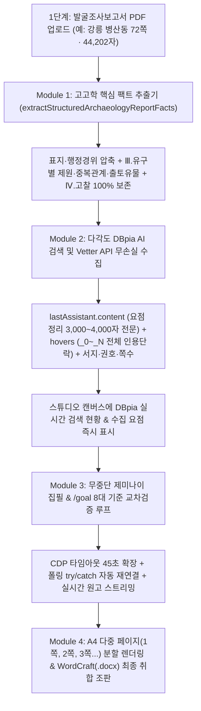

# 🏛️ ARCHAEO STUDIO 5.0 — 핵심 자료·DBpia AI 요점·발굴보고서 데이터 완전 수집 및 무중단 다중 페이지 아키텍처 개발 플랜

> **작성일**: 2026-10-18  
> **목적**: 강릉 병산동 발굴조사보고서(72쪽 · 44,202자) 실전 구동 중 확인된 **4대 불안정 요소(① DBpia AI 요점 95% 절단, ② 보고서 후반부 핵심 유구·유물 절단, ③ CDP 15초 타임아웃 중간 멈춤, ④ DBpia 검색 비가시성 및 단일 페이지 늘어짐)**를 REA(리버스 엔지니어링) 실증 데이터 기반으로 완벽히 해결하기 위한 상세 개발 계획서.

---

## 1. 문제 진단 및 REA 실증 원인 분석 (Root Cause Analysis)

| 구분 | 현상 (사용자 확인 문제) | REA 및 코드 실증 분석으로 확인된 실제 원인 |
| :--- | :--- | :--- |
| **문제 1** | **DBpia AI의 핵심 요점을 제대로 보지 못함** | `extractLatestDbpiaAnswer()`(`gemini_mcp_server.js` 3942~3988행)에서 DOM의 `[class*="useMarkdownComponents_"]`(개별 문단 태그) 중 **맨 마지막 태그 1개(139~172자)**만 `answerText`에 담고, `if (!answerText)` 조건 때문에 정작 Vetter JSON API(`agent.dbpia.co.kr/vetter_conversations/{id}`)의 **`lastAssistant.content`(3,000~4,000자 핵심 요점 전문)**를 덮어쓰지 않고 버림. 또한 `lastAssistant.hovers`에서도 논문별 복수 인용 단락(`_0`, `_1`, `_2`) 중 첫 번째만 남기고 260자로 절단함. |
| **문제 2** | **발굴조사보고서 PDF(72쪽, 44,202자)의 핵심 유구·유물 데이터 누락** | 발굴보고서 PDF는 앞부분(1~25쪽)이 표지·목차·조사경위·자연환경이고, 정작 고찰 작성의 핵심인 **Ⅲ. 조사내용(유구별 평면형태·규모·내부시설·중복관계·출토유물)**과 **Ⅳ. 고찰·맺음말**은 중·후반부(25,000~44,202자)에 위치함. 기존 코드는 무작정 `reportText.slice(0, 35000)`으로 앞부분만 잘라 뒷부분 핵심 유구·유물 데이터를 유실함. |
| **문제 3** | **65%(본문 집필 중)에서 중간에 멈춤 (`CDP command timeout`)** | 35,000자(수천 줄)의 원문을 제미나이 `.ql-editor`에 수천 개의 `
` DOM 노드로 삽입하고 0.5초마다 전체 DOM을 `cloneNode(true)`로 복제해 읽어들임. 생성이 5분 이상 길어질 때 브라우저 메인 스레드가 무거워져 단일 `Runtime.evaluate` 호출이 15초를 넘기자 `try/catch` 없이 즉시 파이프라인 전체가 `ABORTED` 됨. |
| **문제 4** | **DBpia 검색 과정이 안 보이고, 종이가 한 페이지로만 길게 늘어짐** | ① DBpia 검색이 백그라운드 웹뷰에서만 돌고 스튜디오 우측 화면에 **실시간 검색 질의·수집 논문·핵심 요점**이 표시되지 않음. ② 스튜디오 우측 미리보기 종이(`.as-page`)가 단일 `<article>`로만 되어 있어 글이 길어지면 페이지가 넘어가지 않고 한 장으로 끝없이 길어짐. |

---

## 2. 4대 핵심 개선 모듈 상세 설계

### 2.1 [Module 1] 발굴조사보고서 지능형 고고학 팩트 추출기 (`extractStructuredArchaeologyReportFacts`)
- **대상 파일**: [`scripts/gemini_mcp_server.js`](file:///C:/Users/kyi25/.gemini/config/plugins/gemini-desktop/scripts/gemini_mcp_server.js)
- **설계 내용**:
  1. 업로드된 보고서 전체 텍스트(길이 제한 없이 전체 스캔)를 장·절(`Ⅰ. 조사경위`, `Ⅱ. 위치와 환경`, `Ⅲ. 조사내용`, `Ⅳ. 고찰`, `Ⅴ. 맺음말`) 및 유구 번호(`1호 주거지`, `2호 주거지`, `1호 수혈` 등) 단위로 파싱합니다.
  2. **핵심 데이터 4대 영역 우선 추출 (총 22,000자 이내 고밀도 압축)**:
     - **① 유적 개요 및 조사 현황**: 유적명, 행정구역, 조사면적, 확인 유구 기수(예: 주거지 N기, 수혈 N기, 고분 N기).
     - **② 유구별 상세 기술 및 중복·층위 관계**: 각 호별 평면형태(`방형`, `장방형`, `철자형(凸)`, `여(呂)자형`), 규모(`장축×단축×깊이`, 면적), 내부시설(`노지`, `부뚜막`, `구들`, `주공`, `벽구`), **유구 간 파괴·중복 선후관계**.
     - **③ 출토유물 상세 및 속성표**: 경질무문토기, 타날문토기, 단경호, 개배, 고배, 철기(쇠삽날, 철부, 철겸), 석기 등 유물 설명 및 제원.
     - **④ 기존 보고서 고찰·결론부 전문**: 보고서 후반부의 `고찰` 및 `맺음말` 단락을 잘림 없이 전수 포함.
  3. 추출된 실제 유적명·핵심 유구 형태·표징 유물을 기반으로 **DBpia AI 맞춤형 검색어 3종**을 생성합니다.

### 2.2 [Module 2] DBpia AI Vetter API 요점 전문(`lastAssistant.content`) + 전 인용 단락(`hovers`) 100% 무손실 수집기
- **대상 파일**: [`scripts/gemini_mcp_server.js`](file:///C:/Users/kyi25/.gemini/config/plugins/gemini-desktop/scripts/gemini_mcp_server.js) (`extractLatestDbpiaAnswer`, `formatCollectedDbpiaBlock`)
- **설계 내용**:
  1. **Vetter API `lastAssistant.content` 최우선 채택**:
     - 기존 `if (!answerText && (lastAssistant.content || lastAssistant.answer))` 버그를 수정하여, Vetter API의 `lastAssistant.content`(또는 `lastAssistant.answer`)가 존재하고 DOM 텍스트보다 길거나 구조화되어 있으면 **무조건 Vetter API의 마크다운 요점 전문(3,000~5,000자 전체)으로 덮어씁니다.**
     - DOM 폴백 시에도 마지막 문단 1개가 아니라 AI 답변 컨테이너 전체의 텍스트를 결합합니다.
  2. **논문별 모든 인용 단락(`hovers`) 통합 보존**:
     - `lastAssistant.hovers` 내 `NODE01511668_0`, `NODE01511668_1`, `NODE01511668_2` 등 동일 논문의 모든 발췌 단락을 버리지 않고 배열로 모아 결합(최대 900자/논문)하여, 실제 논문에서 인용된 수치·연대·비교 근거가 빠짐없이 제미나이에 전달되게 합니다.
  3. **`formatCollectedDbpiaBlock()` 무손실 전달**:
     - `liveResearchFeed`의 관점별 DBpia AI 요점 정리 전문을 기존 `900자` 절단에서 **최대 `3,500자`(사실상 전문)**로 대폭 확대하여 제미나이가 DBpia AI의 분석 요점을 100% 활용하도록 합니다.

### 2.3 [Module 3] CDP 무중단(Zero-Timeout) 집필 및 자동 복구 엔진
- **대상 파일**: [`scripts/gemini_mcp_server.js`](file:///C:/Users/kyi25/.gemini/config/plugins/gemini-desktop/scripts/gemini_mcp_server.js) (`withCdpSession`, `_askGeminiWebImpl`)
- **설계 내용**:
  1. **CDP 명령 타임아웃 확장 (`15,000ms` ➔ `45,000ms`)**: 대용량 프롬프트 주입이나 긴 마크다운 변환 시에도 타임아웃이 발생하지 않도록 여유 시간을 3배로 늘립니다.
  2. **폴링 루프 내 개별 `try/catch` 방어 및 세션 자동 재연결**:
     - `_askGeminiWebImpl`의 폴링 주기를 `500ms` ➔ `1,200ms`로 조정하여 브라우저 렌더링 부하를 줄입니다.
     - 폴링 도중 단일 `send("Runtime.evaluate")`가 타임아웃되거나 WebSocket이 일시 끊기더라도 **절대 `throw`로 파이프라인을 죽이지 않고**, 자동으로 CDP 세션을 재연결하여 이미 작성 중이거나 완료된 제미나이 본문을 끝까지 회수합니다.
  3. **프롬프트 주입 최적화**: 수천 줄의 프롬프트를 주입할 때 빈 줄이 연속되면 압축하고 문단 단위로 가볍게 삽입하여 `.ql-editor` DOM 노드 수를 최소화합니다.

### 2.4 [Module 4] DBpia 실시간 검색 보드 & A4 다중 페이지(1쪽, 2쪽, 3쪽...) 자동 분할 뷰어
- **대상 파일**: [`scripts/standalone_studio_app.js`](file:///C:/Users/kyi25/.gemini/config/plugins/gemini-desktop/scripts/standalone_studio_app.js)
- **설계 내용**:
  1. **DBpia 검색 중 실시간 리서치 보드 표시**:
     - 파이프라인이 2단계(`PHASE_2_DBPIA_LOOP`)를 실행하는 동안 우측 A4 화면이 비어있지 않고, **현재 DBpia AI에 질문 중인 검색어 + 실시간으로 수집된 논문 목록(저자, 연도, 논문명, 학술지, 핵심 인용 단락) + DBpia AI 요점 정리**가 실시간으로 화면에 추가되어 눈으로 직접 확인할 수 있습니다.
  2. **A4 다중 페이지 자동 분할 렌더링 (`renderManuscriptOntoA4Page`)**:
     - 한 페이지로 길게 늘어지던 단일 `<article class="as-page">` 구조를 개편하여, 원고 분량에 맞춰 **A4 1쪽, 2쪽, 3쪽... 독립된 여러 장의 종이 시트(`.as-page`)로 자동 페이지 나눔(Pagination)**을 수행합니다.
     - 각 A4 페이지 상단에는 문서 머리글, 하단에는 각주(해당 페이지 인용분 또는 말미 각주)와 **`- 1 -`, `- 2 -`, `- 3 -` 페이지 번호**가 표시되며, 하단 상태바에도 실제 페이지 수(`쪽 1 / 8` 등)가 정확히 표시됩니다.
  3. **최종 단계 일괄 취합 및 WordCraft(`.docx`) 조판**:
     - 모든 수집 데이터(발굴보고서 핵심 유구·유물 팩트 + DBpia AI 3단계 요점 전문 + 검증 논문 서지·각주 + 표 2종 + 차트·모식도)를 `/goal` 8대 기준으로 교차검증한 뒤 최종 `.docx`로 컴파일하여 `WordCraft`에 엽니다.

---

## 3. 구현 및 검증 순서
1. **`scripts/gemini_mcp_server.js` 업데이트**:
   - `extractStructuredArchaeologyReportFacts()` 구현 (72쪽 이상 대형 발굴보고서 PDF에서 유구·유물·중복관계·고찰 핵심 팩트 무손실 추출)
   - `extractLatestDbpiaAnswer()` 및 `formatCollectedDbpiaBlock()` 수정 (Vetter API `lastAssistant.content` 전문 + `hovers` 전 단락 무손실 수집)
   - `withCdpSession()` 45초 타임아웃 및 `_askGeminiWebImpl()` 폴링 `try/catch` 자동 재연결 구현
2. **`scripts/standalone_studio_app.js` 업데이트**:
   - DBpia AI 실시간 검색·요점·수집 논문 라이브 프리뷰 렌더링 추가
   - A4 다중 페이지(`1쪽`, `2쪽`, `3쪽`...) 자동 분할 렌더링 및 페이지 카운터 연동
3. **강릉 병산동 발굴조사보고서(72쪽 PDF) 실전 검증**:
   - 브리지 서버 재시작 후 강릉 병산동 보고서 데이터 + DBpia 16편 요점 전문을 바탕으로 중간 멈춤 없이 `/goal` 8/8 교차검증 및 다중 페이지 `.docx` 생성이 완료되는지 검증
4. **설계도·스킬 반영 및 GitHub 푸시 (`main`)**
